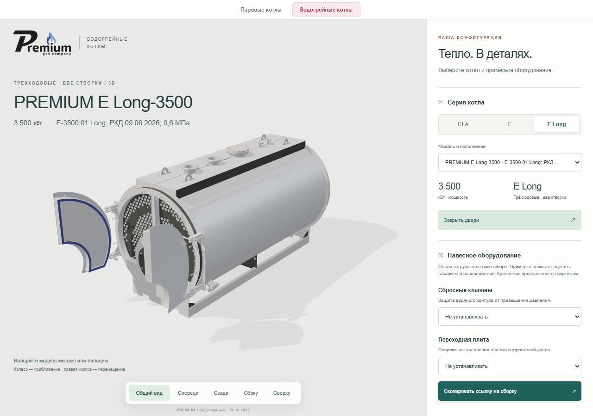
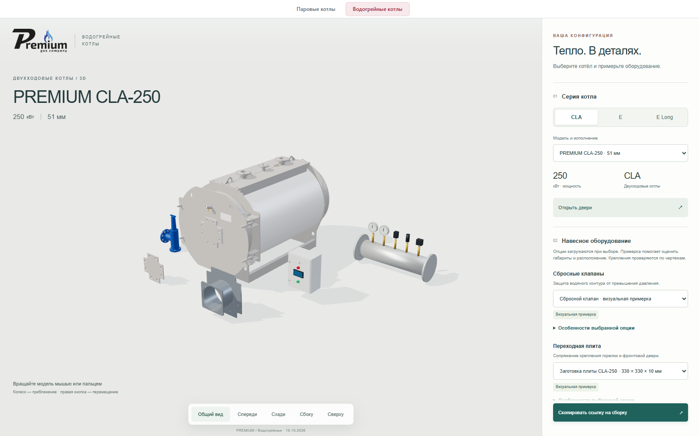

# Проверка водогрейного раздела

Исторический протокол первоначальной публикации. Классификация серий и температурные исполнения уточнены в [выпуске 2026.10.20.2](releases/2026.10.20.2.md); приведённые ниже SHA и результаты относятся к 19.10.2026.

Версия **2026.10.19.2**, **19.10.2026**, исполнитель **Codex / GPT-6**.

Статус публикации: **PUBLISHED_FILES_AND_BROWSER_VERIFIED**. [Открыть на основном сайте](https://prgz.ru/komplektacii4/?section=hotwater&hwModel=cla-250-57&v=2026.10.19.2).

Исходный коммит сборки: `5dc6cf6960a89a2c81ef41080165d4f50cf8215f`.
SHA-256 опубликованного манифеста: `c95efb81fbabc52e8d19e31269e1e083bf5474f50817c60266b71da697fe8417`.
Все production-отчёты ниже относятся к этим байтам. GitHub CI не настроен; локальные и браузерные проверки не называются CI.

## Проверки

| Область | Результат и доказательство |
|---|---|
| Источники | 48 STEP, 372 056 318 байт, SHA совпали при повторном чтении; исходники не изменены. [Реестр](evidence/source-integrity.json) |
| Производные GLB | 48 моделей и 9 опций, размеры/SHA/Meshopt/узлы дверей проверены. [Проверка каталога](evidence/catalog-verification.json) |
| Сжатие | 295 269 328 → 68 070 804 байта для котлов, −76,95%; уникальные треугольники и CAD-узлы сохранены. Максимальное изменение габарита при сжатии 0,037 мм. [Отчёт](evidence/model-compression.json) |
| Все модели в браузере | 48/48 на локальной production-сборке и публичном stage: размеры по фактическим вершинам, опоры на полу, открытие/закрытие всех 61 дверей/створок, один выбранный GLB на страницу. [Stage-отчёт](evidence/all-models-stage.json) |
| Изоляция загрузки | 4/4 проверки фактического Vite-графа: отдельные модули, CSS и каталоги; начальная оболочка не содержит GLB. [Отчёт](evidence/sections.json) |
| Водогрейный интерфейс | Три семейства, пять категорий опций, сдвиг/поворот, восстановление URL и мобильный экран 390 px. Stage и основной адрес PASS. [Основной сайт](evidence/browser-live.json) |
| Жизненный цикл | 6/6: выбор и подсветка детали после instancing, отмена загрузки, освобождение GPU, повтор после ошибки, сбой опции и переходы разделов. [Отчёт](evidence/lifecycle-stage.json) |
| Паровой раздел | 13 вариантов, все девять мощностей, ограничения комплектаций, шкаф каскада, проставка и предпросмотр КП. Stage и основной адрес PASS. [Основной сайт](evidence/steam-live.json) |
| TypeScript и правила | `tsc -b`, 19 тестов комплектации/ДА/видимости/URL и три теста старого бюджета моделей PASS. Исправлено устаревшее ожидание экономайзера в тесте; продуктовое правило от 12.10.2026 не менялось. |
| Публикация | 195 серверных файлов сверены по SHA, 190 статических HTTPS-ответов проверены, включая 157 GLB. [HTTP main](evidence/http-live.json), [краткий протокол](evidence/publication.json) |
| Выпуск/возврат | 9 локальных тестов publisher, включая успешный обмен/rollback, восстановление при сбое после обмена, остановку при drift и правила кэша. Фактический cutover выполнен атомарно; рабочий rollback не запускался. |

В процессе полного прогона найден зазор над полом у 12 сборок: консервативный bbox повёрнутых деталей завышал габарит. Версия .2 использует точные вершины для посадки модели и опций. После исправления все 48 вариантов проверены повторно. Версия .1 была только предварительным stage и не заменяла основной сайт.

## Скорость

Котлы суммарно занимают 68,07 МБ, с девятью опциями — 68,98 МБ. Каталог — 68 378 байт. На странице скачивается одна выбранная сборка размером от 0,77 до 2,18 МБ; опции загружаются при выборе. В неподвижной сцене рендер останавливается, повторные детали объединяются для отрисовки. Геометрия внутренних деталей сохранена.

Четыре холодных запуска локальной production-сборки в Chrome с ограничением сети 4/1 Мбит/с и задержкой 80 мс:

| Модель | Медиана двух запусков до кадра модели | Все сетевые ресурсы |
|---|---:|---:|
| CLA-250, 57 мм — по умолчанию | 3,629 с | 1,329 МБ |
| CLA-6000, 51 мм — самый тяжёлый GLB | 6,377 с | 2,703 МБ |

Во всех запусках ровно один выбранный GLB, паровых моделей — ноль. Параллельно шли другие браузерные проверки; CPU/GPU не замедлялись. Это локальные наблюдения, не замер мобильного устройства или обещание времени для любого соединения. [Методика](PERFORMANCE.md), [JSON](evidence/loading-benchmark.json).

На Beget GLB кэшируются на год с `immutable`, JS/CSS — на семь дней, HTML/JSON перепроверяются. Имена ресурсов содержат хеш. `.vite/manifest.json` через HTTP закрыт: 403. [Подробности](CACHE.md).

## Публикация и границы

Основной адрес переключён с 2026.10.12.1 атомарным обменом каталогов. До переключения прочитана и проверена локальная резервная копия. Прежняя публикация сохранена в `komplektacii4-before-hotwater-v2026.10.19.2`; свежая проверка после переключения подтвердила её SHA. 100 прежних GLB, `api/*` и проверенные соседние страницы сохранены без изменения. Почтовые endpoints не вызывались, заявки не отправлялись.

`VISUAL_REVIEW_CANDIDATE` в исходных метаданных сборки — статус пакета перед публикацией. Факт размещения и браузерной проверки фиксируется отдельным [протоколом публикации](evidence/publication.json).

Каталог использует заводские названия CLA/E/E Long. Соответствие коммерческим названиям «тепличный» и «для перегретой воды» остаётся на уточнении. Подробный отбор и обе ревизии CLA/Long описаны в [SOURCES.md](SOURCES.md).

Опции представлены для визуальной примерки в натуральном масштабе, с перемещением и поворотом. Часть аксессуаров восстановлена из PDF/DXF; длина коллектора и глубина шкафов приняты для визуализации. Сбросной клапан использует существующую геометрию паровой сборки. Совместимость креплений, DN, уставки и применимость к водяному контуру не подтверждаются визуальной проверкой. Эти ограничения видны в карточках, происхождение раскрыто в [OPTIONS.md](OPTIONS.md).

