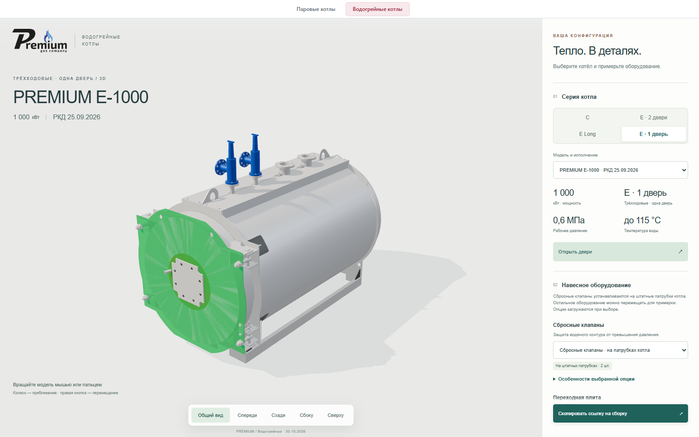
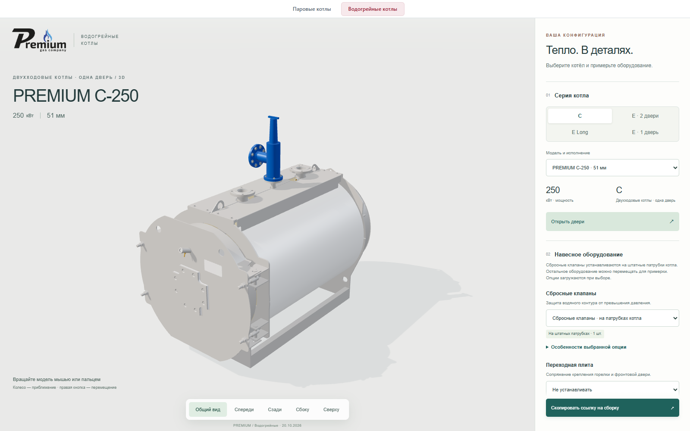

# Сбросные клапаны на заводских патрубках

Версия **2026.10.20.2**, дата **20.10.2026**, исполнитель **Codex / GPT-6**.
Статус: **PUBLISHED_FILES_AND_BROWSER_VERIFIED**. Предыдущая опубликованная версия: **2026.10.19.2**.
[Открыть котёл с клапанами](https://prgz.ru/komplektacii4/?section=hotwater&hwModel=e-1000-20260925&hwOptions=relief-shape&v=2026.10.20.2). Кандидат 2026.10.20.1 оставлен на stage без переключения основной страницы.

Ранее включённый сбросной клапан отображался рядом с котлом. Теперь форма клапана совмещается входной присоединительной плоскостью с верхней плоскостью штатного фланца. Количество определяется заводской сборкой: один у 27 моделей Premium C, два у 21 модели Premium E, E Long и обновлённой однодверной E. Всего 69 мест на 48 моделях.

Координаты получены из исходных преобразований заводских фланцев, подтверждены назначением штуцеров в чертежах и сохраняют связь с SHA исходника и GLB. Нижняя точка габаритов клапана не используется: она принадлежит крепежу, выступающему ниже присоединительной поверхности на 9 мм. Старые пользовательские смещения клапана в `hwLayout` игнорируются и удаляются из ссылки; свободное перемещение остальных опций сохранено.

Один файл клапана используется для обоих экземпляров пары. Геометрия не масштабируется, исходные 157 GLB не изменены. Загружаются только выбранные котёл и оборудование. Направление бокового выхода — визуальный выбор, исходная сборка не задаёт трассу сброса.

Габаритная форма клапана сохранена из прежнего каталога: вход DN40. Заводские фланцы котлов имеют DN32, DN40, DN50, DN65 и DN80. Исправление подтверждает расположение, количество и оси, но не подбор конкретного водяного клапана, DN/PN, пропускной способности и давления настройки. Это указано в особенностях опции.

Выпуск также включает подтверждённое владельцем разделение серий из кандидата 2026.10.20.1:

- CLA отображается как Premium C.
- Premium E с двумя дверями: 0,6 МПа / 115 °C и 1 МПа / 150 °C.
- Premium E Long — тепличное исполнение с двумя дверями.
- Обновлённая РКД Premium E 25.09.2026 — трёхходовое исполнение с одной дверью.

Существующие идентификаторы моделей и ссылки сохранены. Подробные источники: [SOURCES.md](../SOURCES.md), [монтажные точки](../safety-mount-evidence.json).

## Воспроизведение

1. `build_safety_mounts.py --metadata <converted-metadata> --output <evidence.json>` проверяет исходные фланцы всех моделей.
2. `apply_safety_mounts.py <evidence.json>` переносит только проверенные точки и измеренную привязку клапана в каталог.
3. `verify_catalog.mjs` сверяет метаданные, идентичность GLB и существование каждого occurrence.
4. `check-safety-mounts.mjs <preview-url> <output>` проверяет в браузере все 48 моделей / 69 точек, реальную геометрию, масштаб, оси и загрузку одного файла клапана для пары.
5. `check-browser.mjs` проверяет четыре серии, старую ссылку со смещением клапана, свободное перемещение остальных опций и мобильную компоновку.

## Проверки

- TypeScript/build — PASS. 8 тестов конфигурации и разделения загрузки — PASS. 14 тестов publisher — PASS.
- [Все 48 моделей и 61 дверь на stage](../evidence/2026.10.20.2/all-models-stage.json): PASS, ошибок JavaScript нет.
- [Все 69 точек установки](../evidence/2026.10.20.2/safety-mounts-stage.json): PASS. Реальный входной центр, оси, масштаб и исходный occurrence проверены; для пары загружается один файл клапана.
- [Четыре серии и пять категорий опций на основном адресе](../evidence/2026.10.20.2/browser-live.json): PASS; проверены старая ссылка со смещением клапана, остальные перемещаемые опции, мобильная компоновка и давления/температуры.
- [6 проверок жизненного цикла](../evidence/2026.10.20.2/lifecycle-stage.json) и [4 проверки разделения загрузки](../evidence/2026.10.20.2/sections.json): PASS.
- Паровые конфигурации: 13/13 PASS [на stage](../evidence/2026.10.20.2/steam-stage.json) и [на основном сайте](../evidence/2026.10.20.2/steam-live.json); ошибки отсутствуют.
- [HTTP основного сайта](../evidence/2026.10.20.2/http-live.json): 190 статических ответов и все 195 серверных файлов соответствуют сборке. [Итог публикации](../evidence/2026.10.20.2/publication.json).

GitHub Actions: **CI_NOT_CONFIGURED**. Эти результаты получены локально и в браузере, а не в CI.

## Сборка и публикация

Исходный коммит: `5ea018821670e1ad1a6134ee6fca14fff3d884c2`.
SHA-256 манифеста: `a29e0ad1e835d13ef4f77c4854585e59ee2ba9e2081124de2edeb9030721a60c`.
SHA-256 каталога: `b38b9dc1bcafcc50d20036b0f0c5b4d086ffb1401ee0dd0e66e0ff707d6643e4`.

Переключение выполнено 20.10.2026 в 16:27:47 UTC атомарным обменом каталогов. Перед заменой сохранена и проверена резервная копия всех 195 файлов предыдущей версии. Кандидат перенёс 11 новых файлов (335 643 байта), 184 файла повторно использованы после проверки SHA. Все 157 GLB, почтовый API и проверенные соседние страницы сохранены. API не вызывались, заявки не отправлялись. Резервная серверная папка: `komplektacii4-before-hotwater-v2026.10.20.2`. Рабочий rollback не выполнялся.

