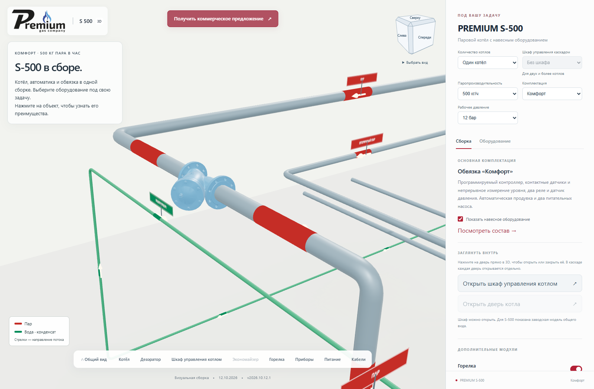
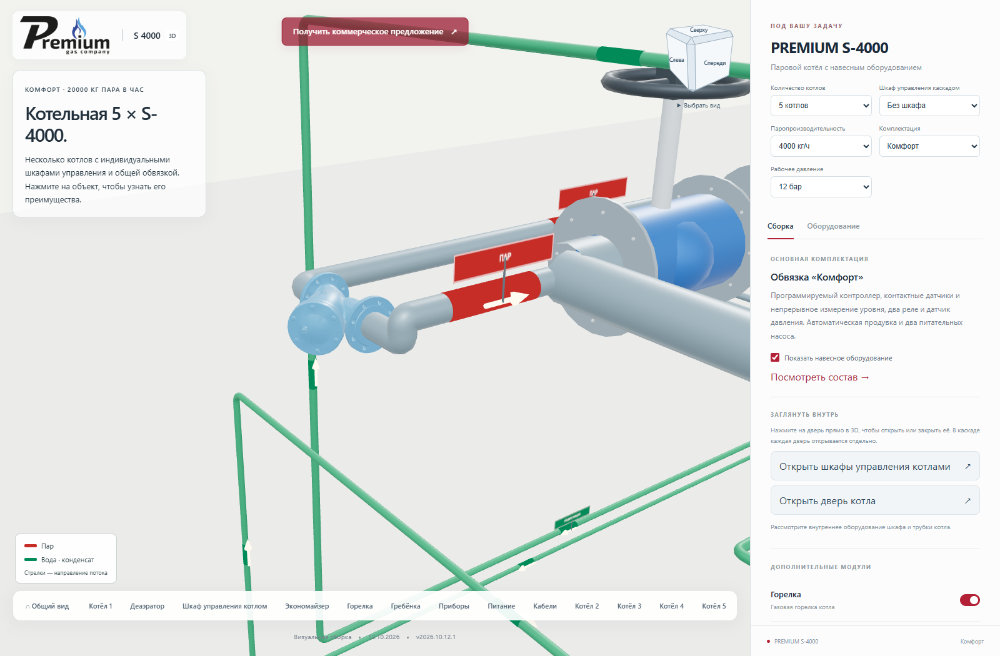
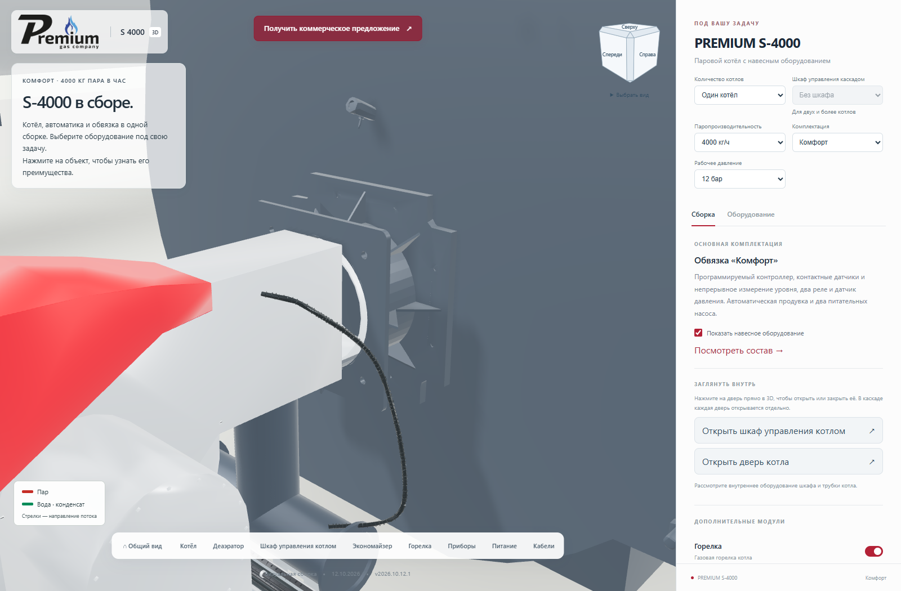
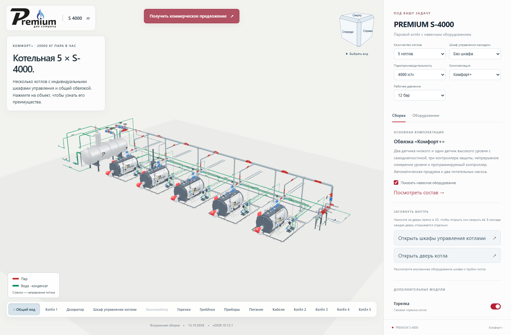

# Комплектации, отдельный каскадный шкаф и монтажные узлы

**Версия 2026.10.12.1 · 12.10.2026 · Codex / GPT-6.**

Статус: **PUBLISHED_VERIFIED**.

Количество котлов (1–5) теперь выбирается независимо от шкафа управления
каскадом. Рядом появился отдельный выбор «Без шкафа / Установить».
По умолчанию шкаф не выбран. Он доступен при двух и более котлах в
«Комфорт» и «Комфорт+». Общая обвязка остаётся и без него. При отключении
убираются сам шкаф, его опоры, линии связи и датчик общего коллектора.
Это отражается в 3D, списке оборудования, навигации, ссылке и запросе КП.

| Комплектация | Модуляция питательной воды | Экономайзер | Каскадный шкаф |
|---|---|---|---|
| Стандарт | Недоступна | Недоступен | Недоступен |
| Комфорт | Дополнительная опция | При выбранной модуляции | Дополнительная опция, 2–5 котлов |
| Комфорт+ | Включена, отключение недоступно | Доступен | Дополнительная опция, 2–5 котлов |

Сохранено ограничение экономайзера для котлов от 1500 кг/ч. Отключение
модуляции в «Комфорт» отключает экономайзер. Переход в «Стандарт» удаляет
все три несовместимые опции. Сервер формы повторяет эти правила, в том
числе для старых URL. Новый параметр ссылки — `cascadeCabinet=1`;
параметр `cascade` сохраняет только количество котлов.

Фильтр АДЛ перенесён по последнему снимку владельца на верхний прямой
участок перед спуском к регулирующей арматуре деаэратора. Отстойник
расположен сбоку. Между торцами труб оставлено 350 мм под корпус фильтра;
труба не проходит внутри его модели. Перенос применяется ко всем пяти
вариантам деаэраторов. Фильтр имеет отдельную карточку и подсветку.

Использована существующая производная модели **АДЛ IS16 DN100** из
[CAD-библиотеки производителя](https://adl.ru/cad-library/).
Архив SAT повторно проверен: SHA-256
`c15131aafe7e647ac5b41ca78eddbc91cdbca6f498e9cd5fa9b3083c3a8acebc`.
[Карточка IS16](https://adl.ru/truboprovodnaya-armatura/filtry-setchatye-adl-is16.html)
сверена 12.10.2026. Исходная модель и её файл GLB не изменены.

Два сбросных трубопровода каждого котла продолжены от существующих
открытых концов до общей внешней границы обвязки (Y = 8,5 м).
Линии остаются раздельными; штатные отводы у клапанов сохранены.

Проставка горелки построена из приложенного DXF PR.05.01.013-05 и
сверена с PDF: длина 200 мм, фланцы 14 мм, фигурный контур 550 × 550 мм
с восемью отверстиями и второй фланец 455 × 455 мм с четырьмя отверстиями.
Показаны труба и рёбра жёсткости. Материал взят у серого корпуса котла.
Удалены прежние условные кольцо, плита и относящийся к ним крепёж.
Горелка смещена к наружному фланцу. Проставка движется вместе с дверью
S-4000 и скрывается вместе с горелкой. Она используется в существующей
представительной модели горелки семейства; исходный чертёж подписан C-3000.
Это изменение веб-визуализации, исходные заводские STEP/DXF не менялись.

Контур хранится в JSON размером 1379 байт. Проставка содержит 2496
треугольников, заменяет 846 треугольников старого крепления и добавляет
один вызов отрисовки на котёл. Все 100 GLB сохранены без изменений.
Новые тяжёлые модели или текстуры не загружаются.

## Проверка

18 локальных тестов: ограничения комплектаций, все 45 комбинаций
мощности/количества, независимость общего шкафа от обвязки, новое место
фильтра и описания оборудования. PHP проверен с подставным почтовым
транспортом; настоящие письма не отправлялись.

Браузерная проверка охватывает все девять мощностей, одиночную сборку,
несколько котлов с общим шкафом и без него, переходы между тремя
комплектациями, сохранение ссылки, просмотр КП и движение проставки
вместе с дверью. Отдельно проверяются стыки фильтра, концы сбросных
линий, ошибки JavaScript и шейдеров.

Команда: `node tools/cascade/check_configuration_20261012.mjs <base-url/> <output-directory>`.
Требуется `S3000_BROWSER_RUNTIME` с Playwright.

Публикация выполняется через отдельный проверяемый каталог, с резервной
копией предыдущего выпуска и проверкой соседних страниц. Основная страница проверена после переключения.

## Опубликованный выпуск

[Открыть 2026.10.12.1](https://prgz.ru/komplektacii4/?power=4000&trim=comfort&pressure=12&addons=burner%2Ceconomizer%2Cdeaerator%2Cmodulation%2Cgpz%2Cbdv%2Cfv&v=2026.10.12.1).

- Исходники: `ba95663e1f01f610b3c6bc792515789faa7bdaca`.
- Производственная сборка: `2993a87332742c2e35e32817f945cb47126fd17c`.
- SHA-256 манифеста: `e98a1d489cb794648b322f2546b97c4e945c7c18605c6fda0be12a08373d5728`.
- 128 серверных файлов проверены перед переключением; 125 файлов проверены
  по HTTPS на промежуточной и основной страницах.
- Все 100 файлов GLB совпадают с предыдущим выпуском.
- Передано 9 изменённых файлов (462 691 байт архива), остальные 119 переиспользованы.
- Предыдущая версия сохранена в `komplektacii4-before-cascade-v2026.10.12.1`.
- Соседние страницы и корневые настройки сайта не изменены.
- GitHub CI: `CI_NOT_CONFIGURED`. Браузерная проверка и публикация выполнены отдельно.

Протоколы: [сводка](verification.json), [локальная сборка](browser-local.json),
[промежуточный сайт](browser-stage.json), [основной сайт](browser-live.json),
[HTTPS промежуточного сайта](http-stage.json), [HTTPS основного сайта](http-live.json),
[форма КП без отправки писем](quote-endpoint.json).

Откат: `python tools/cascade/publish.py rollback`. Команда сверяет сохранённую
публикацию и текущую версию, возвращает предыдущий каталог и сохраняет
откатываемый выпуск отдельно.
